<div align="center">



<br/><br/>

[](https://github.com/Bishnucd/EXCO/releases/latest) [](.) [](.) [](LICENSE)

### EXCO — Local-First AI Workspace & Engineering Desktop App

[**Download Windows Installer (`EXCO-0.1.0-Setup.exe`)**](https://github.com/Bishnucd/EXCO/releases/latest)

</div>

---

<details open>
<summary><b>What Is EXCO?</b></summary>

<br/>

- **Native Desktop AI Workspace**: Standalone Windows app combining chat and code workflows without browser limits.
- **Dual Modes**: Switch instantly between **Chatbot Mode** (streaming chat & attachments) and **Work Mode** (project files, editor & terminal).
- **Multi-Provider Freedom**: Connect Google Gemini, OpenAI, Anthropic, Groq, Mistral, OpenRouter, Ollama, or any custom OpenAI-compatible gateway.
- **Zero-Mock Architecture**: Uses only your own API keys or local models—no shared keys or simulated outputs.
- **Private & Local-First**: Conversations save locally in SQLite; API keys stay encrypted in Windows Credential Manager.

</details>

---

<details>
<summary><b>How EXCO Works (Core Workflow)</b></summary>

<br/>

```text
Renderer UI (React 18: Chatbot Mode • Work Mode • Settings)
   │  Typed contextBridge (window.exco)
   ▼
Main Process (Zod IPC Validation • Keytar / AES-256-GCM Vault • SQLite WASM)
   ├──▶ Model Router      — Auto / Turbo / Standard / Deep Thought + 429 Failover
   ├──▶ Workspace & PTY   — Scoped folder guards + embedded node-pty xterm.js shell
   └──▶ Skills & Updates  — 780+ built-in skills, MCP tools, background GitHub updater
```

- **1. Choose Mode & Attach Context**: Prompt with text, images, PDFs, audio/video, or code files in Chatbot or Work Mode.
- **2. Route by Workflow**: Select **Auto**, **Turbo** (fast), **Standard** (balanced), or **Deep Thought** (reasoning), or pin any live model.
- **3. Automatic Failover**: If a provider hits a `429` rate limit or quota cap and **Fallback** is on, EXCO switches to your next active key.
- **4. Scoped Work Mode Execution**: Open one or more project folders under **Ask Every Time**, **Selected Workspace Access**, or **Full Access** with an integrated terminal.
- **5. Skills, MCP & Customization**: Enable bundled skills (`skills/`), attach external MCP servers, and pick from **100 curated wallpapers** or custom backgrounds.
- **6. Background Auto-Updates**: Checks GitHub Releases on startup and every 30 minutes; installs only when you click **Restart & Apply Update**.

</details>

---

<details>
<summary><b>How to Add API Keys & Supported Providers</b></summary>

<br/>

- **Step 1**: Open **Settings → API Keys** inside EXCO.
- **Step 2**: Paste an API key (or choose **Ollama / Custom** to set a local URL); EXCO auto-detects the provider, encrypts the key, and loads its live models.
- **Step 3**: Toggle **Fallback** to allow automatic cross-provider switching during rate limits.

| Provider | Key / Endpoint Input | Where to Get Keys |
| :--- | :--- | :--- |
| **Google Gemini** | Paste `AIza...` key (sent in headers only) | [aistudio.google.com](https://aistudio.google.com/) |
| **OpenAI** | Paste `sk-...` key | [platform.openai.com/api-keys](https://platform.openai.com/api-keys) |
| **Anthropic** | Paste `sk-ant-...` key | [console.anthropic.com](https://console.anthropic.com/) |
| **Groq Cloud** | Paste `gsk_...` key | [console.groq.com](https://console.groq.com/) |
| **Mistral AI** | Paste Mistral API key | [console.mistral.ai](https://console.mistral.ai/) |
| **OpenRouter** | Paste `sk-or-...` key (`100+` models) | [openrouter.ai/keys](https://openrouter.ai/keys) |
| **Ollama (Local)** | URL `http://localhost:11434` (offline, no key) | [ollama.com](https://ollama.com/) |
| **Custom Gateway** | Custom Base URL + optional API key | Any OpenAI-compatible server |

</details>

---

<details>
<summary><b>Quick Start (Install or Build Locally)</b></summary>

<br/>

- **Windows Installer**: Download and run [`EXCO-0.1.0-Setup.exe`](https://github.com/Bishnucd/EXCO/releases/latest) (1-click per-user install, Desktop & Start Menu shortcuts, auto-updates enabled).
- **Build from Source** *(Node.js 18+, npm 9+)*:

```bash
git clone https://github.com/Bishnucd/EXCO.git
cd EXCO
npm install
npm run dev    # Run locally with hot reload
npm run dist   # Build dist/electron/EXCO-0.1.0-Setup.exe
```

</details>

---

Open-source under the [MIT License](LICENSE).
